# VESPH Care — Virtual Engagement System for Patient Health
## Comprehensive Technical System Documentation & Architectural Specification

---

## Executive Summary

**VESPH Care** (Virtual Engagement System for Patient Health) is an intelligent, multi-agent post-discharge clinical coordination platform. It bridges the critical communication and compliance gap between inpatient hospital discharge and outpatient recovery by delivering:

1. **An Empathetic Patient Portal:** Features structured recovery timelines, diagnostic reports, discharge instructions, mealtime-grouped medication tracking (Breakfast, Lunch, Dinner with live checkoff), appointment management with auto-accepted slot rescheduling, and an interactive Care Assistant.
2. **A High-Efficiency Doctor Portal:** Tailored for attending physicians (modeled around Lead Laparoscopic Surgeon **Dr. Rhea Mehta**), featuring a weekly clinic agenda across active patients, schedule blocking with automated conflict rebooking, patient clinical chart reviews, and a **RAG Consultation Document Ingestion Agent** that reads doctor consultation notes/PDFs and synchronizes updates directly into the live clinical database.
3. **A Hybrid Agent Architecture:** Powered by LangGraph, Groq LLM (`openai/gpt-oss-20b`), and live Supabase PostgreSQL storage, combining deterministic clinical safety guards with scoped generative intelligence.
4. **Production-Ready AWS EC2 Infrastructure:** Packaged for persistent 24/7 background operation via `systemd` and Nginx reverse proxying with WebSocket upgrade support.

---

## 1. Master System Architecture & Symmetric Multi-Agent Flow

The diagram below presents the comprehensive, highly detailed architecture flow uniting the **Doctor Practice Portal** and the **Patient Care Portal** through specialized agents, interactive verification gates, the live Supabase PostgreSQL relational database layer, and real-time cross-portal reactive synchronization:

```mermaid
graph TD
    %% CLIENT ENTRY POINTS & ROLE ROUTING
    InboundInteraction([Inbound User Interaction · Doctor or Patient]) --> PortalRouting{Portal Role Routing}

    %% =========================================================================
    %% 🩺 DOCTOR PRACTICE PORTAL FLOWS (Dr. Rhea Mehta)
    %% =========================================================================
    subgraph DoctorPortal["🩺 Doctor Portal Multi-Agent Ecosystem (Dr. Rhea Mehta)"]
        PortalRouting -->|Doctor Persona| DocUI[Doctor Portal Client UI<br/>• OPD Clinic Agenda with Day/Week Tabs<br/>• Doctor Clinical Assistant Chat<br/>• Consultation PDF/Text Uploader<br/>• Patient Clinical Chart Modal]
        
        DocUI --> DocOrch[Doctor Orchestrator · doctor_orchestrator.py]
        DocOrch --> DocClassifier{Intent Classifier & Entity Parser<br/>Regex & Groq NLP}

        %% Flow 1: Schedule & Appointment Count Flow
        DocClassifier -->|CHECK_SCHEDULE<br/>e.g., 'what is my schedule on 22nd'| DocSchedAgent[Doctor Schedule & Count Agent]
        DocSchedAgent --> DateParser[Safe Word-Boundary Date Parser<br/>regex: \b(2[0-9]|3[01]|1[0-9]|[1-9])(st|nd|rd|th)?\b<br/>Defaults to viewed week's month]
        DateParser --> SchedQuery[(Query appointments Table<br/>Filter by doctor_id & parsed date)]
        SchedQuery --> SchedFormat[Format Structured OPD Table<br/>Exact appointment count, patient names, short IDs,<br/>timeslot intervals, and status badges]

        %% Flow 2: Doctor Unavailability & Conflict Rebooking Flow
        DocClassifier -->|BLOCK_UNAVAILABILITY<br/>e.g., 'I am not available on 22nd'| DocAvailAgent[Doctor Availability & Rebooking Agent]
        DocAvailAgent --> ConflictDetector[(Detect Conflicting Appointments<br/>in appointments Table for target date)]
        ConflictDetector --> AvailProposal[Generate Verification Proposal<br/>Lists affected patients & computed fallback slots<br/>e.g., 26, 27, 28 Oct · Avoids blocked date!]
        AvailProposal --> DocAvailGate{Doctor Confirms?<br/>'yes' / 'confirm'}
        DocAvailGate -->|Rejects / Cancels| AvailCancel[Cancel Proposal & Retain Status]
        DocAvailGate -->|Doctor Confirms| ExecAvailCommit[(Execute Transaction in Supabase:<br/>1. INSERT doctor_unavailability<br/>2. UPDATE appointments SET appointment_datetime=fallback,<br/>   status='Pending'<br/>3. INSERT escalation_agent_data priority notice)]
        ExecAvailCommit --> AvailReceipt[Format Unavailability Receipt<br/>'Verified in Supabase · Patients notified of reschedule']

        %% Flow 3: Patient Record & Clinical Facet Lookup Flow
        DocClassifier -->|PATIENT_QUERY<br/>e.g., 'Tell me about Neha Kapoor' / 'what meds is Ananya taking'| DocPatientAgent[Patient Verification & Facet Agent]
        DocPatientAgent --> FuzzyRoster{Fuzzy Match in patients Table?<br/>Full Name / First / Last Name}
        FuzzyRoster -->|Not Found| RosterSample[Clarify with 5-Patient Roster Sample<br/>Show Names & Short IDs PID-XXXX]
        FuzzyRoster -->|Verified Patient: PID-8421| FacetBranch{Detect Inquired Clinical Facet}
        FacetBranch -->|Medications / Rx| FacetMedQuery[(Query prescription_details + medicines<br/>Deduplicate dosage & brand e.g. 'Dolo 650 mg')]
        FacetBranch -->|Appointments / Schedule| FacetApptQuery[(Query appointments Table<br/>Upcoming & past visits with short IDs APT-XXXX)]
        FacetBranch -->|Clinical Summary / General| FacetSumQuery[(Fetch longitudinal patient_summary<br/>Surgical history, vitals & demographics)]
        FacetMedQuery --> FormatChart[Format Rich Clinical Profile Card<br/>with Demographics, short IDs, active meds, and visits]
        FacetApptQuery --> FormatChart
        FacetSumQuery --> FormatChart

        %% Flow 4: RAG Consultation Document Ingestion Pipeline Flow
        DocClassifier -->|CLINICAL_NOTE<br/>Upload PDF or Paste Raw Consultation Note| DocIngestAgent[Clinical Document Ingestion Agent]
        DocIngestAgent --> InputTypeCheck{Input is PDF?}
        InputTypeCheck -->|Yes| PDFExtract[extract_text_from_pdf via pypdf<br/>Iterate page text streams]
        InputTypeCheck -->|No: Text| RawNoteText[Direct Text Stream]
        PDFExtract --> GroqNLP[Groq Clinical NLP Extraction<br/>Model: openai/gpt-oss-20b · Strict JSON Schema<br/>Extract: Diagnosis, Vitals, Mealtime Meds, Follow-up]
        RawNoteText --> GroqNLP
        GroqNLP --> IngestPreviewGate[Clinical Verification Preview Gate<br/>Display extracted entities with checkmarks<br/>Prompt: 'Confirm to update Supabase records?']
        IngestPreviewGate --> DocIngestConfirm{Doctor Confirms?<br/>'yes' / 'confirm'}
        DocIngestConfirm -->|Rejects| IngestAbort[Clear pending state & discard staging]
        DocIngestConfirm -->|Doctor Confirms| MultiTableCommit[(Transactional Commit across 5 Supabase Tables:<br/>1. UPDATE patients.patient_summary<br/>2. INSERT consultations CON-1001<br/>3. INSERT appointments APT-1001, status='Confirmed'<br/>4. INSERT prescription_details MED-6661<br/>5. INSERT diagnostics & diagnostics_results LAB-1001)]
        MultiTableCommit --> IngestReceipt[Format Ingestion Receipt<br/>Displays verified short IDs & prompts inspection in Patient View]

        %% Flow 5: Doctor Chit-Chat Deflection Flow
        DocClassifier -->|CHIT_CHAT / Off-Topic<br/>e.g., 'hello', 'what is the weather'| DocChitChat[Doctor Chit-Chat Deflection Agent]
        DocChitChat --> DocScopeHelp[Clarify Practice Management Capabilities<br/>Schedule checks, leave blocking, patient records, note ingestion]
    end

    %% =========================================================================
    %% 👤 PATIENT CARE PORTAL FLOWS (Ananya Iyer)
    %% =========================================================================
    subgraph PatientPortal["👤 Patient Portal Multi-Agent Ecosystem (Ananya Iyer)"]
        PortalRouting -->|Patient Persona| PatUI[Patient Portal Client UI<br/>• Recovery Timeline & Surgical Milestones<br/>• Mealtime Medication Cards Breakfast/Lunch/Dinner<br/>• Diagnostic Download Center & Histopathology<br/>• Patient Care Assistant Chat<br/>• 15m Cadence Reschedule Modal]
        
        PatUI --> PatOrch[Patient Orchestrator<br/>orchestrator/patient_orchestrator.py · LangGraph StateGraph]
        PatOrch --> PatClassifier{Intent & Safety Classifier<br/>Red-Flag Keyword & NLP Router}

        %% Flow 6: Deterministic Safety & Emergency Escalation Flow
        PatClassifier -->|Emergency / Wrong Report / Acute Symptoms<br/>e.g., 'severe chest pain', 'wrong blood report'| PatEscalationAgent[Safety & Escalation Agent]
        PatEscalationAgent --> EmergencyGuide[Immediate Deterministic Safety Advice<br/>'Call +91 22 4000 1122 or nearest emergency room']
        EmergencyGuide --> CreateEscalationTicket[(Insert escalation_agent_data<br/>status='Open', priority='Critical', escalated_at=NOW)]
        CreateEscalationTicket --> PromptResolutionActions[Display Interactive Action Buttons<br/>'Request report reissue' / 'Contact Clinical Coordinator']
        PromptResolutionActions --> PatResolutionChoice{Patient Clicks Action}
        PatResolutionChoice --> UpdateEscalationTicket[(UPDATE escalation_agent_data<br/>status='Resolved', resolved_at=NOW)]

        %% Flow 7: Natural Language Medication Intake Flow
        PatClassifier -->|Natural Intake Confirmation<br/>e.g., 'I took dolo' / 'took my pantocid'| PatIntakeParser[Natural Intake Handler]
        PatIntakeParser --> MatchActiveRx{Match Active Prescription in DB?<br/>Resolve Brand Name / Medicine ID}
        MatchActiveRx -->|Matched: Dolo 650 mg| ToggleMedDB[(Call toggle_prescription_taken_in_supabase<br/>UPDATE prescription_details SET is_taken=TRUE<br/>WHERE prescription_item_id = :id)]
        ToggleMedDB --> ReEvalNotif{Are all meal medications taken?}
        ReEvalNotif -->|All Taken| DismissMealCard[Dismiss Medication Check Alert Card<br/>from Notification Centre]
        ReEvalNotif -->|Pending Doses Remain| KeepRemainingCard[Retain Alert Card for Remaining Doses]
        DismissMealCard --> ConfirmIntakeReply[Post Warm Conversational Confirmation<br/>'Great job! Marked Dolo 650 mg taken in hospital records']
        KeepRemainingCard --> ConfirmIntakeReply

        %% Flow 8: Proactive Reminders & Reschedule Convergence Flow
        PatClassifier -->|Upcoming Visits / Dosing / Fasting<br/>e.g., 'when is my appointment', 'fasting rules'| PatReminderAgent[Reminder & Scheduling Agent]
        PatReminderAgent --> CheckApptStatus{Check Appointment Status in DB}
        CheckApptStatus -->|status == 'Pending' or 'Rescheduled'<br/>e.g. Doctor moved visit| RescheduleAlert[Render Action Required Banner<br/>'⚠️ Doctor schedule adjusted to 26 Oct. Confirm or rebook']
        RescheduleAlert --> PatReschedAction{Patient Chooses Action}
        PatReschedAction -->|Clicks 'Confirm'| ConfirmSlot[(UPDATE appointments SET status='Confirmed')]
        PatReschedAction -->|Clicks 'Reschedule'| OpenSlotPicker[Display 15m Cadence Slots<br/>Select alternative date & time with 5m buffers]
        OpenSlotPicker --> SaveNewSlot[(UPDATE appointments SET appointment_datetime=new_dt,<br/>status='Pending')]
        CheckApptStatus -->|status == 'Confirmed'| NormalReminder[Standard 1-Day Advance Reminder<br/>Preparation instructions & room location]
        NormalReminder --> FastingCheck{Diagnostic Test Requires Fasting?}
        FastingCheck -->|Yes: Lipid / Sugar| FastingAdvice[Deliver Fasting Protocol: 10-12 hr overnight fast]
        FastingCheck -->|No| RoutinePrep[Routine Clinic Arrival Instructions]

        %% Flow 9: Longitudinal Summary & Adherence Trends Flow
        PatClassifier -->|Summary / Biomarkers / Adherence<br/>e.g., 'how is my recovery', 'adherence'| PatSummaryAgent[Summary & Trends Agent]
        PatSummaryAgent --> QueryBiomarkers[(Query consultations + diagnostics_results)]
        QueryBiomarkers --> CalcAdherence[Calculate Prescribed vs Taken Ratio<br/>e.g., '1 of 3 taken · 33% adherence']
        CalcAdherence --> FormatRecoveryTrend[Format Clinical Recovery Summary<br/>WBC trend, surgical clearance, diet stage]

        %% Flow 10: Doctor Profile Lookup Flow
        PatClassifier -->|Doctor Inquiry<br/>e.g., 'Tell me about Dr. Rhea Mehta'| PatDocSummaryAgent[Doctor Profile Agent]
        PatDocSummaryAgent --> QueryDoctorProfile[(Query doctors Table<br/>Name, qualifications, department, room)]
        QueryDoctorProfile --> FormatDocProfile[Format Attending Physician Credentials Card]

        %% Flow 11: Scoped LLM Chit-Chat Fallback Flow
        PatClassifier -->|General Question / Off-Topic| GroqPatientFallback[Groq LLM Scoped Fallback]
        GroqPatientFallback --> ScopedPrompt[PATIENT_SYSTEM_PROMPT<br/>Hospital-Scoped Recovery · Refuse General Life Advice]
    end

    %% =========================================================================
    %% 🗄️ LIVE SUPABASE POSTGRESQL PERSISTENCE LAYER (10 Tables)
    %% =========================================================================
    subgraph DataPersistence["🗄️ Live Supabase Cloud PostgreSQL Data Layer (10 Relational Tables)"]
        T_Patients[(patients<br/>Demographics, Longitudinal Summary, Short ID PID-XXXX)]
        T_Doctors[(doctors<br/>Attending Physician Profiles, Room, Short ID DOC-XXXX)]
        T_Appointments[(appointments<br/>Strict appointment_status_enum: Confirmed, Pending, Rescheduled, Cancelled, Completed)]
        T_Unavailability[(doctor_unavailability<br/>Blocked Dates, Leave Records)]
        T_Consultations[(consultations<br/>Encounter Vitals, Diagnoses, Short ID CON-XXXX)]
        T_Medicines[(medicines<br/>Pharmaceutical Catalog)]
        T_Prescriptions[(prescription_details<br/>Meal Timings: breakfast/lunch/dinner, is_taken status)]
        T_Diagnostics[(diagnostics<br/>Laboratory Orders, Short ID LAB-XXXX)]
        T_DiagResults[(diagnostics_results<br/>Biomarker Readings, WBC, Reference Ranges)]
        T_Escalations[(escalation_agent_data<br/>Emergency Tickets, Priority Alerts, Resolution Records)]
    end

    %% DATABASE BINDINGS: DOCTOR
    SchedQuery -.-> T_Appointments
    ConflictDetector -.-> T_Appointments
    ExecAvailCommit -.-> T_Unavailability
    ExecAvailCommit -.-> T_Appointments
    ExecAvailCommit -.-> T_Escalations
    FuzzyRoster -.-> T_Patients
    FacetMedQuery -.-> T_Prescriptions
    FacetMedQuery -.-> T_Medicines
    FacetApptQuery -.-> T_Appointments
    FacetSumQuery -.-> T_Patients
    MultiTableCommit -.-> T_Patients
    MultiTableCommit -.-> T_Consultations
    MultiTableCommit -.-> T_Appointments
    MultiTableCommit -.-> T_Prescriptions
    MultiTableCommit -.-> T_Diagnostics
    MultiTableCommit -.-> T_DiagResults

    %% DATABASE BINDINGS: PATIENT
    CreateEscalationTicket -.-> T_Escalations
    UpdateEscalationTicket -.-> T_Escalations
    ToggleMedDB -.-> T_Prescriptions
    CheckApptStatus -.-> T_Appointments
    ConfirmSlot -.-> T_Appointments
    SaveNewSlot -.-> T_Appointments
    QueryBiomarkers -.-> T_Consultations
    QueryBiomarkers -.-> T_DiagResults
    QueryDoctorProfile -.-> T_Doctors

    %% UI OUTPUT BINDINGS
    SchedFormat --> DocUI
    AvailReceipt --> DocUI
    AvailCancel --> DocUI
    FormatChart --> DocUI
    RosterSample --> DocUI
    IngestReceipt --> DocUI
    IngestAbort --> DocUI
    DocScopeHelp --> DocUI

    EmergencyGuide --> PatUI
    UpdateEscalationTicket --> PatUI
    ConfirmIntakeReply --> PatUI
    ConfirmSlot --> PatUI
    SaveNewSlot --> PatUI
    FastingAdvice --> PatUI
    RoutinePrep --> PatUI
    FormatRecoveryTrend --> PatUI
    FormatDocProfile --> PatUI
    ScopedPrompt --> PatUI

    %% =========================================================================
    %% 🔄 BIDIRECTIONAL CROSS-PORTAL REACTIVE SYNCHRONIZATION
    %% =========================================================================
    ExecAvailCommit ==>|1. Doctor Blocks Date & Shifts Slot| RescheduleAlert
    MultiTableCommit ==>|2. Doctor Ingests Note: Updates Meds/Appts/Labs| PatUI
    ToggleMedDB ==>|3. Patient Takes Med: Live Checkoff Sync| FacetMedQuery
    SaveNewSlot ==>|4. Patient Reschedules Slot| DocUI
```

---

## 2. Detailed Flowcharts for Key Operational Flows

### Flow A: Doctor Unavailability & Automated Patient Conflict Rebooking

When an attending surgeon marks a day or timeslot unavailable, conflicting patient appointments are detected, moved to distinct future slots, and set to **`Pending`** status:

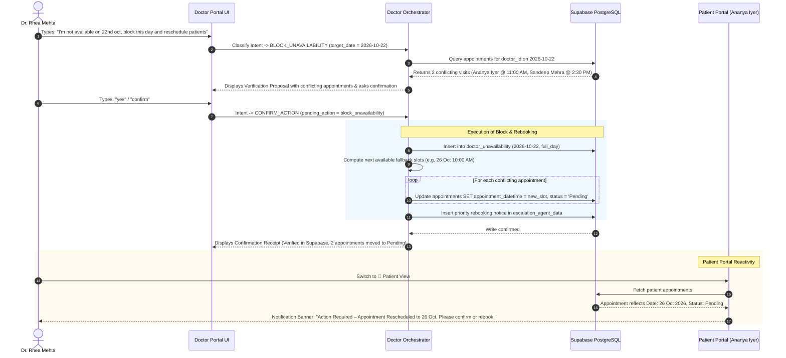

---

### Flow B: Doctor Patient Clinical Facet Lookup ("Tell me about Neha Kapoor")

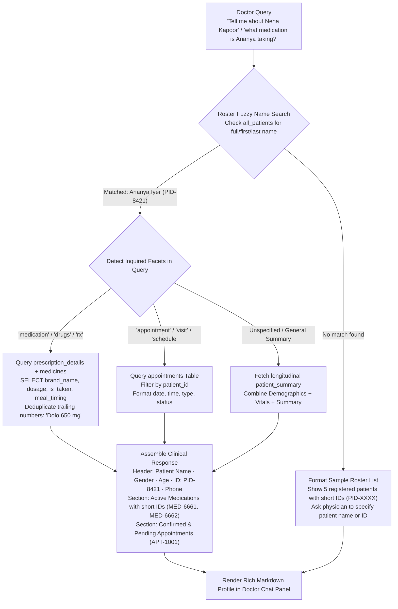

---

### Flow C: RAG Consultation Document Ingestion Pipeline

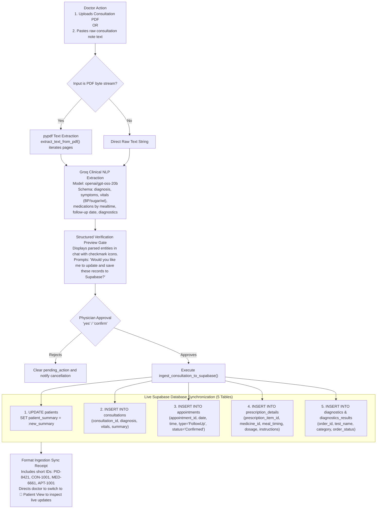

---

### Flow D: Patient Natural Language Medication Intake & Notification Dismissal

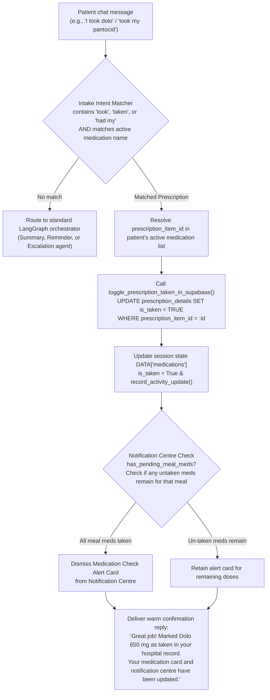

---

### Flow E: Patient Self-Service Reschedule Convergence

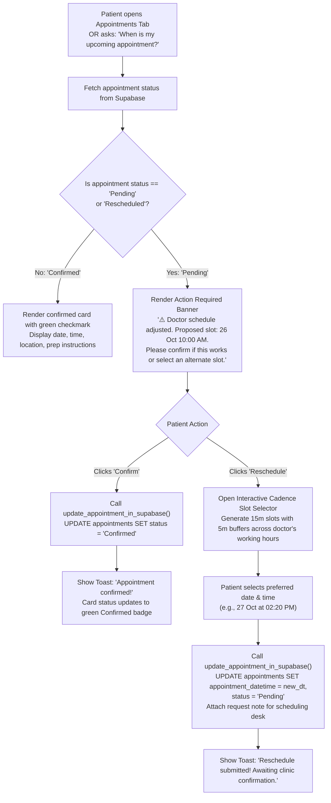

---

### Flow F: Doctor Dynamic Schedule & Exact Appointment Count Query

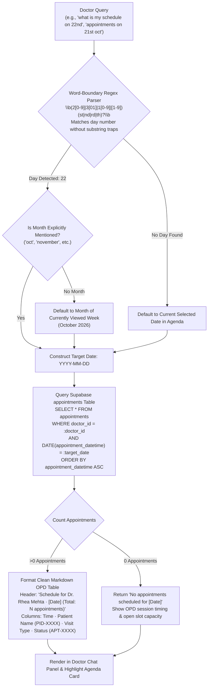

---

### Flow G: Patient Emergency Safety Escalation & Resolution Lifecycle

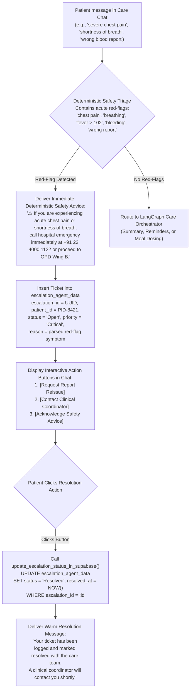

---

### Flow H: Longitudinal Recovery Tracking, Biomarkers & Medication Adherence

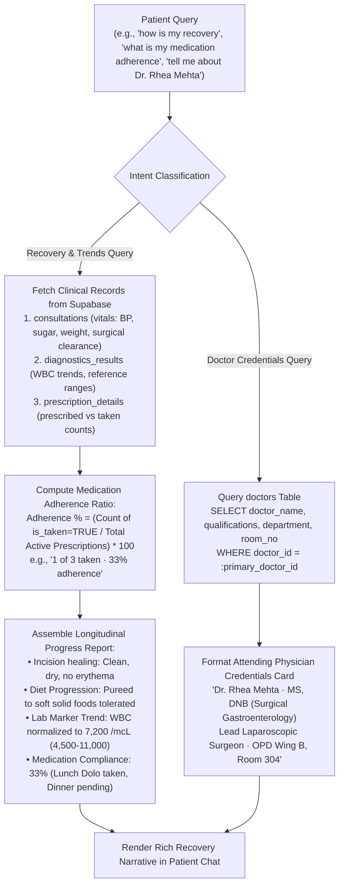

---

## 3. Appointment State Transition Machine & PostgreSQL Enum Hardening

In the live Supabase PostgreSQL database, the `appointments.status` column is strictly constrained to the custom enum `appointment_status_enum`. Any unmapped text representation throws error `22P02`. VESPH Care implements canonical normalization to enforce deterministic state transitions:

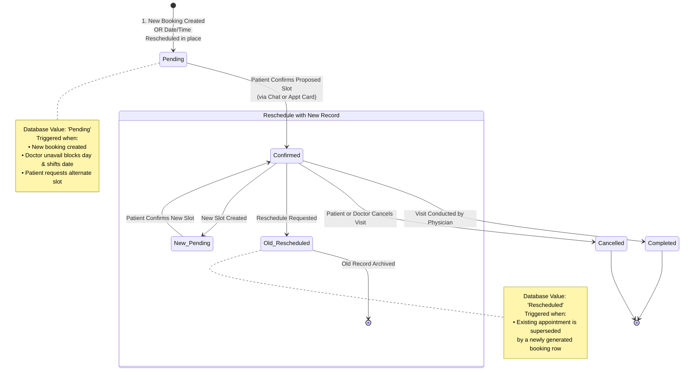

### PostgreSQL Status Normalization Mapping (`tools/db_tools.py`)

```python
VALID_APPOINTMENT_STATUSES = {
    "Confirmed",
    "Pending",
    "Completed",
    "Cancelled",
    "Rescheduled",
}

STATUS_NORMALIZATION_MAP = {
    "reschedule pending": "Pending",  # Date is changing, awaiting confirmation
    "rescheduled": "Rescheduled",
    "reschedule": "Pending",
    "pending confirmation": "Pending",
    "pending": "Pending",
    "confirmed": "Confirmed",
    "cancelled": "Cancelled",
    "canceled": "Cancelled",
    "completed": "Completed",
    "doctor unavailable (reschedule required)": "Cancelled",
    "doctor unavailable": "Cancelled",
    "unavailable": "Cancelled",
}
```

---

## 4. Standardized Short Identifier (ID) System Specification

To prevent raw 36-character UUID strings from cluttering the clinical user interface and conversational chat, VESPH Care implements a centralized short ID system:

| Entity Type | Raw Database Type | Short ID Format | Example | Source Generator |
|---|---|---|---|---|
| **Patient** | UUID v4 | `PID-XXXX` | `PID-8421` | `short_patient_id(pid)` |
| **Doctor** | UUID v4 | `DOC-XXXX` | `DOC-RHEA-01` | `short_doctor_id(did)` |
| **Medicine** | UUID v4 | `MED-XXXX` | `MED-6661` | `short_medicine_id(mid)` |
| **Appointment** | UUID v4 | `APT-XXXX` | `APT-1001` | `short_appointment_id(aid)` |
| **Consultation** | UUID v4 | `CON-XXXX` | `CON-1001` | `short_consultation_id(cid)` |
| **Diagnostic Lab** | UUID v4 | `LAB-XXXX` | `LAB-1001` | `short_diagnostic_id(did)` |

---

## 5. Relational Database Schema & Data Dictionary

VESPH Care operates on 10 interconnected tables hosted on a live Supabase PostgreSQL instance:

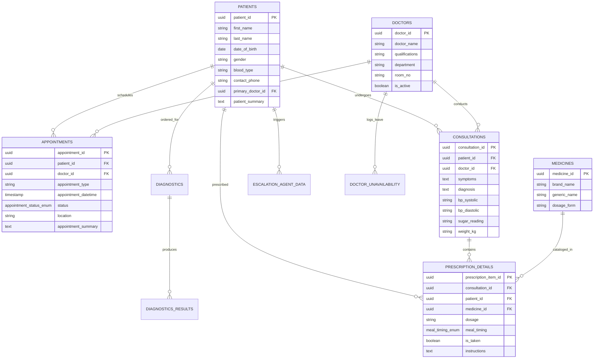

---

## 6. AWS EC2 Production Deployment & Cloud Architecture

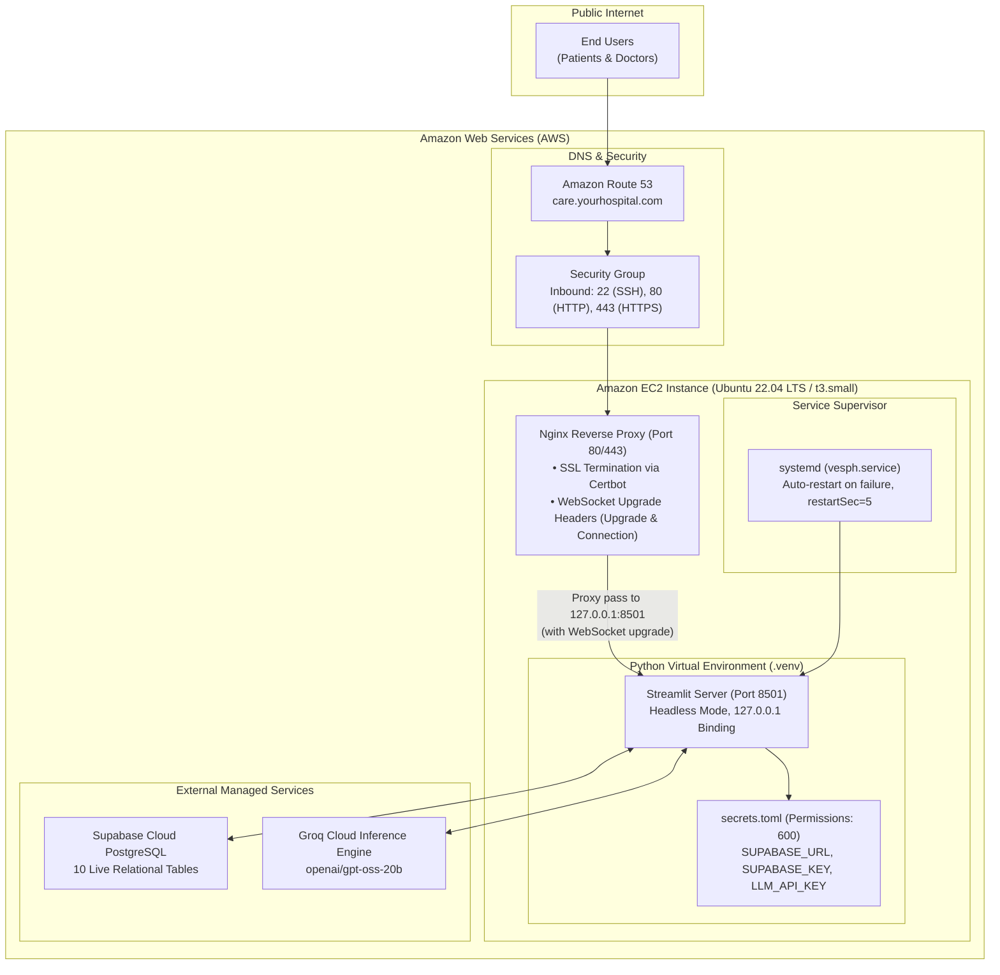

### Production `systemd` Configuration (`/etc/systemd/system/vesph.service`)
```ini
[Unit]
Description=VESPH Care Streamlit Service
After=network.target

[Service]
User=ubuntu
WorkingDirectory=/home/ubuntu/VESPH
ExecStart=/home/ubuntu/VESPH/.venv/bin/streamlit run app.py --server.port 8501 --server.address 127.0.0.1 --server.headless true --browser.gatherUsageStats false
Restart=always
RestartSec=5
Environment=PATH=/home/ubuntu/VESPH/.venv/bin:/usr/bin:/bin

[Install]
WantedBy=multi-user.target
```

### Production Nginx Reverse Proxy Configuration (`/etc/nginx/sites-available/vesph`)
```nginx
server {
    listen 80;
    server_name care.yourhospital.com;

    location / {
        proxy_pass http://127.0.0.1:8501;
        proxy_http_version 1.1;

        # WebSocket support (Critical for Streamlit reactive components)
        proxy_set_header Upgrade $http_upgrade;
        proxy_set_header Connection "upgrade";

        proxy_set_header Host $host;
        proxy_set_header X-Real-IP $remote_addr;
        proxy_set_header X-Forwarded-For $proxy_add_x_forwarded_for;
        proxy_set_header X-Forwarded-Proto $scheme;

        proxy_read_timeout 86400;
        proxy_send_timeout 86400;
    }
}
```

---

## 7. Automated Test Suite Matrix

The platform is validated by 19 automated unit tests covering safety-critical routing, rescheduling state transitions, and database enum compatibility:

| Test Identifier | Target Test Class | Tested User Scenario | Verified Assertion | Status |
|---|---|---|---|---|
| **TEST-01** | `TestPatientOrchestrator` | "Tell me about Dr. Rhea Mehta" | Doctor credentials, qualifications, room number | **PASS** |
| **TEST-02** | `TestPatientOrchestrator` | "What is my recovery trend?" | Historical biomarker trend & surgical clearance | **PASS** |
| **TEST-03** | `TestPatientOrchestrator` | "What is my medication adherence?" | Prescribed vs. taken ratio (33% adherence) | **PASS** |
| **TEST-04** | `TestPatientOrchestrator` | "When is my upcoming appointment?" | Next visit date, location, and prep instructions | **PASS** |
| **TEST-05** | `TestPatientOrchestrator` | "I took dolo" | Natural intake acknowledgment & `is_taken = True` | **PASS** |
| **TEST-06** | `TestPatientOrchestrator` | `normalize_appointment_status` | Maps "Reschedule Pending" strictly to "Pending" | **PASS** |
| **TEST-07** | `TestPatientOrchestrator` | `normalize_appointment_status` | Maps "Doctor Unavailable" strictly to "Cancelled" | **PASS** |
| **TEST-08** | `TestPatientOrchestrator` | `normalize_appointment_status` | Validates all outputs belong to `VALID_APPOINTMENT_STATUSES` | **PASS** |
| **TEST-09** | `TestDoctorOrchestrator` | "What's my schedule on 21st oct?" | Matches appointment count and returns OPD table | **PASS** |
| **TEST-10** | `TestDoctorOrchestrator` | "What's my schedule on 22nd oct?" | Accurately extracts ordinal dates ("22nd oct") | **PASS** |
| **TEST-11** | `TestDoctorOrchestrator` | "What's my schedule on 1st oct?" | Distinguishes single-digit from compound numbers | **PASS** |
| **TEST-12** | `TestDoctorOrchestrator` | "I'm not available on 22nd oct" | Generates unavailability proposal with conflicts | **PASS** |
| **TEST-13** | `TestDoctorOrchestrator` | "Tell me about Ananya Iyer" | Searches patient roster and confirms profile | **PASS** |
| **TEST-14** | `TestDoctorOrchestrator` | "What medication is Ananya Iyer taking?" | Recognizes patient and lists active prescriptions | **PASS** |
| **TEST-15** | `TestDoctorOrchestrator` | "Hello" / "Who are you?" | Responds with doctor capabilities and agenda options | **PASS** |
| **TEST-16** | `TestDoctorOrchestrator` | "Yes" with pending block action | Executes Supabase leave block and rebooking | **PASS** |
| **TEST-17** | `TestDoctorOrchestrator` | Consultation note extraction | Extracts diagnosis, vitals, prescriptions, and follow-ups | **PASS** |
| **TEST-18** | `TestDoctorOrchestrator` | "What's the weather today?" | Deflects non-medical chit-chat to clinical capabilities | **PASS** |
| **TEST-19** | `TestDoctorOrchestrator` | Fallback month matching | Defaults omitted months to active week's month | **PASS** |

Execution command:
```bash
python -m unittest discover tests -v
```

---

## 8. Engineering Challenges & Solutions

| Challenge Encountered | Root Cause | Engineering Solution |
|---|---|---|
| **PostgreSQL 22P02 Enum Error** | Code attempted to set `status = "Reschedule Pending"`, which is not declared in Supabase's `appointment_status_enum`. | Implemented `STATUS_NORMALIZATION_MAP` and `normalize_appointment_status`. When dates are changing, status is automatically normalized to `"Pending"` (awaiting patient confirmation) or `"Rescheduled"` on superseded records. |
| **Medication Name Redundancy** | Brand names in pharmaceutical catalogs sometimes contained dosage numbers (e.g. *Dolo 650*), resulting in display strings like *"Dolo 650 650 mg"*. | Cleaned baseline seed data and implemented regex deduplication `re.sub(r'\s*\d+\s*$', '', brand)` before concatenating dosage strings. |
| **Streamlit WebSocket Drops on EC2** | Streamlit UI became unresponsive or disconnected when accessed through standard HTTP reverse proxies. | Configured Nginx with persistent WebSocket upgrade directives (`proxy_set_header Upgrade $http_upgrade`, `proxy_set_header Connection "upgrade"`, `proxy_read_timeout 86400`). |
| **Raw UUID Visual Clutter** | 36-character hexadecimal UUIDs appeared in appointment cards, charts, and agent replies. | Built a centralized short ID system (`tools/db_tools.py`) mapping UUIDs into clean clinical badges (`PID-8421`, `DOC-RHEA-01`, `MED-6661`, `APT-1001`, `CON-1001`, `LAB-1001`). |
| **Multi-Table RAG Ingestion Sync** | Consultation notes combine diagnosis, vitals, future visits, and drugs into a single text block. | Engineered `tools/consultation_ingestion.py` using `pypdf` and Groq JSON entity extraction, followed by synchronized writes across 5 relational tables upon doctor confirmation. |

---

## 9. Conclusion & Future Roadmap

VESPH Care provides an enterprise-ready blueprint for post-discharge clinical coordination. By fusing deterministic state machines for safety-critical actions with scoped LLM extraction and relational PostgreSQL persistence, it reduces physician administrative overhead while providing patients with clear, structured recovery guidance.

### Future Roadmap
1. **FHIR R4 / HL7 Integration:** Direct bi-directional integration with hospital EHRs (Epic, Cerner).
2. **Omni-Channel Patient Notifications:** Automated WhatsApp Business API and SMS triggers for mealtime medication reminders and schedule change alerts.
3. **Multilingual Regional Support:** Localization for regional Indian languages (Hindi, Marathi, Tamil, Telugu).
4. **Computer Vision Lab Reader:** Multimodal vision parsing of printed pathology and diagnostic imaging reports.
