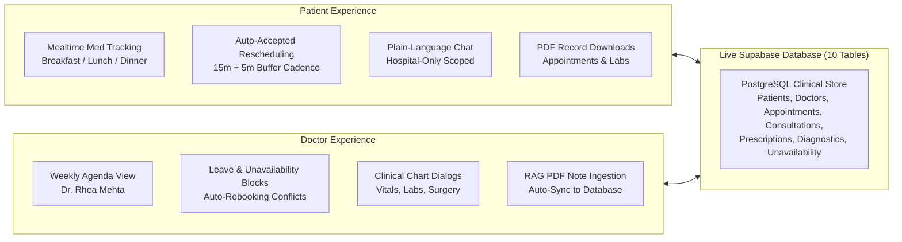
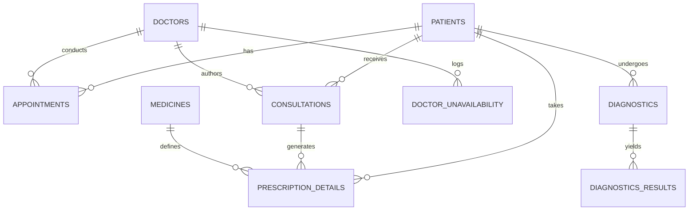
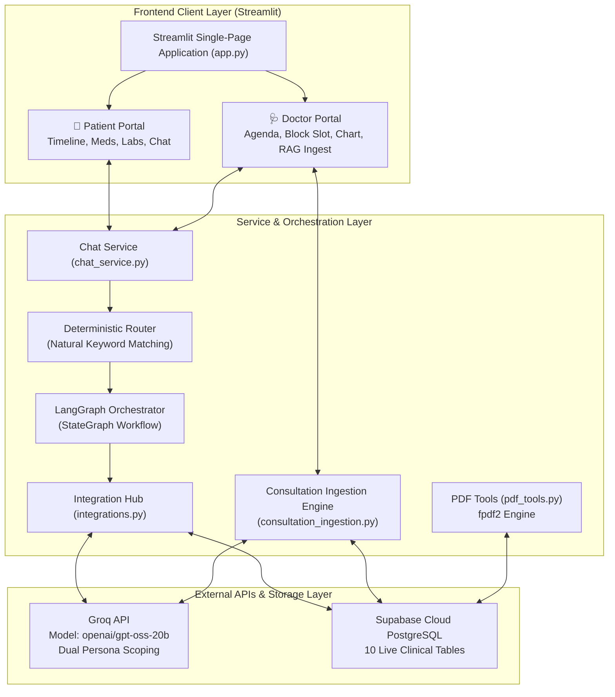
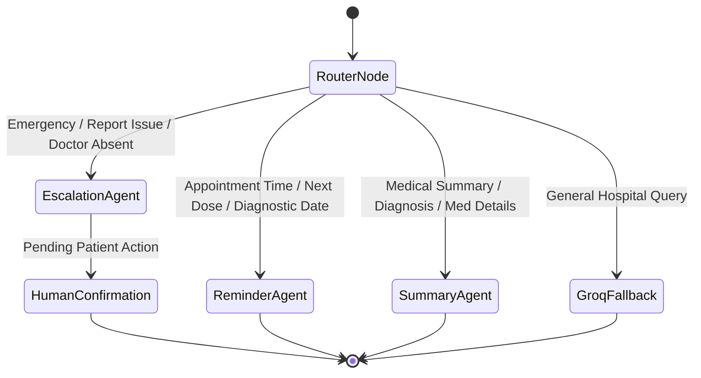
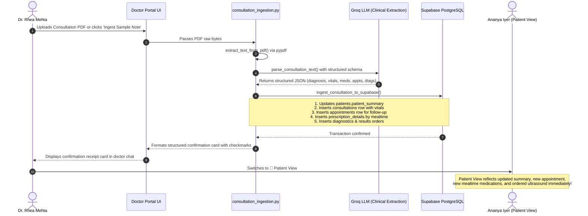
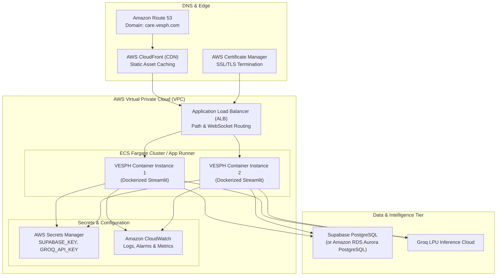

# VESPH Care — Virtual Engagement System for Patient Health
## Comprehensive Technical Capstone Documentation

---

## Executive Summary

**VESPH Care** (Virtual Engagement System for Patient Health) is an intelligent, multi-agent post-discharge clinical coordination platform. It bridges the critical communication gap between hospital discharge and outpatient recovery by providing:
1. **An Empathetic Patient Portal** featuring structured recovery timelines, diagnostic reports, discharge instructions, mealtime-grouped medication tracking (Breakfast, Lunch, Dinner), appointment management with auto-accepted slot rescheduling, and an interactive Care Assistant.
2. **A High-Efficiency Doctor Portal** tailored for attending physicians (modeled around Lead Laparoscopic Surgeon **Dr. Rhea Mehta**), featuring a weekly clinic agenda across active patients, schedule blocking with automated conflict rebooking, patient chart reviews, and a **RAG Consultation Document Ingestion Agent** that reads doctor consultation notes/PDFs and synchronizes updates directly into the live clinical database.
3. **A Hybrid Agent Architecture** powered by LangGraph, Groq LLM (`openai/gpt-oss-20b`), and live Supabase PostgreSQL storage, combining deterministic clinical safety guards with scoped generative intelligence.

---

## 1. Proposed Solution & Value Proposition

### 1.1 The Clinical Challenge
Post-operative and post-discharge recovery is vulnerable to four major failure modes:
- **Medication Non-Adherence:** Patients frequently forget complex dosing schedules or fail to associate tablets with meals.
- **Diagnostic Lapses:** Pre-consultation diagnostics (e.g., repeat CBC or follow-up ultrasounds) are missed before clinic visits, causing delays and wasted appointments.
- **Administrative Friction:** Rescheduling appointments or handling doctor leave is stressful and manual, leading to high no-show rates.
- **Disconnected Clinical Notes:** Consultation notes and prescriptions written on paper or PDF often take days to update electronic health record (EHR) summary fields, leading to stale patient portals.

### 1.2 The VESPH Solution
VESPH Care addresses each challenge through automated, intelligent workflows:

---

## 2. Project Tech Stack

| Layer | Technology | Version | Purpose |
|---|---|---|---|
| **Frontend & UI** | Streamlit | `1.64.0` | Reactive multi-portal web interface with custom CSS design tokens |
| **Agent Orchestration** | LangGraph | `1.2.12` | Deterministic state graph, routing, and conversation checkpointing |
| **LLM Inference** | Groq Python SDK | `1.7.0` | Ultra-fast inference using `openai/gpt-oss-20b` for open-ended queries & clinical NLP |
| **Database & Auth** | Supabase Python | `2.31.0` | Cloud PostgreSQL with relational schema and row-level updates |
| **Document Processing** | pypdf | `6.21.1` | Pure-python PDF text extraction for consultation note ingestion |
| **PDF Generation** | fpdf2 | `2.8.3` | High-fidelity branded PDF report exports and sample consultation documents |
| **Runtime Environment**| Python | `3.12+` | Async execution, dataclasses, strict typing |
| **Typography & Styling**| DM Sans & Manrope | Google Fonts | Clinical healthcare design system with custom CSS variables |

---

## 3. Dataset, Database Schema & State Initialization

### 3.1 Relational Database Architecture (10 Tables)
VESPH Care operates entirely on a live Supabase PostgreSQL instance:

### 3.2 Table Schema Specifications

1. **`patients`**: Core demographic and clinical record.
   - `patient_id` (UUID PK), `first_name`, `last_name`, `date_of_birth`, `gender`, `blood_type`, `contact_phone`, `contact_email`, `address`, `emergency_contact_name`, `emergency_contact_phone`, `primary_doctor_id` (FK), `patient_summary`.
2. **`doctors`**: Clinical staff profiles and credentials.
   - `doctor_id` (UUID PK), `doctor_name`, `qualifications`, `department`, `room_no`, `contact_phone`, `contact_email`, `is_active`.
3. **`appointments`**: Scheduled outpatient and diagnostic visits.
   - `appointment_id` (UUID PK), `patient_id` (FK), `doctor_id` (FK), `appointment_type` (`Consultation`, `FollowUp`, `Diagnostic`), `appointment_datetime`, `status` (`Confirmed`, `Completed`, `Cancelled`), `location`, `appointment_summary`, `reminders_sent_count`, `scheduled_by_role`.
4. **`consultations`**: Inpatient and outpatient clinical encounter logs.
   - `consultation_id` (UUID PK), `appointment_id` (FK), `patient_id` (FK), `doctor_id` (FK), `symptoms`, `diagnosis`, `treatment_plan`, `bp_systolic`, `bp_diastolic`, `sugar_reading`, `height_cm`, `weight_kg`, `consultation_summary`, `recommended_consultation`, `recommended_consultation_date`, `created_at`.
5. **`medicines`**: Master pharmaceutical catalog.
   - `medicine_id` (UUID PK), `brand_name`, `generic_name`, `dosage_form` (`Tablet`, `Inhaler`, etc.).
6. **`prescription_details`**: Patient medication schedule and meal timings.
   - `prescription_item_id` (UUID PK), `consultation_id` (FK), `patient_id` (FK), `medicine_id` (FK), `dosage`, `frequency_per_day`, `duration_days`, `start_date`, `is_taken` (Boolean), `refill_needed` (Boolean), `meal_timing` (`breakfast`, `lunch`, `dinner`, `other`), `instructions`.
7. **`diagnostics`**: Diagnostic laboratory and imaging orders.
   - `order_id` (UUID PK), `appointment_id` (FK), `consultation_id` (FK), `patient_id` (FK), `ordered_by_doctor_id` (FK), `order_status` (`Ready`, `Ordered`), `order_datetime`.
8. **`diagnostics_results`**: Quantitative and qualitative test findings.
   - `result_id` (UUID PK), `order_id` (FK), `test_category`, `test_name`, `result_value`, `reference_range`, `result_summary`, `report_file_url`, `result_datetime`.
9. **`operation`**: Surgical encounter records and discharge state.
   - `operation_id` (UUID PK), `patient_id` (FK), `lead_surgeon_id` (FK), `operation_name`, `scheduled_start_time`, `actual_end_time`, `discharge_summary`.
10. **`doctor_unavailability`**: Scheduled doctor leave and blocked clinic slots.
    - `unavailability_id` (UUID PK), `doctor_id` (FK), `block_type` (`full_day`, `timeslot`), `blocked_date`, `blocked_slot`, `reason`, `created_at`.
11. **`escalation_agent_data`**: Safety escalation and resolution tracking.
    - `ticket_id` (UUID PK), `patient_id` (FK), `category`, `priority`, `status`, `ai_detected_reason`, `resolution_notes`, `resolved_at`.

### 3.3 Canonical Reset Mechanism (`reset_supabase_database`)
To guarantee reproducible demonstrations, `tools/db_tools.py` provides `reset_supabase_database(client)`. This function cleans existing records and re-seeds canonical data:
- Primary patient: **Ananya Iyer** (32F, recovering from laparoscopic appendectomy).
- 6 additional clinic patients across Dr. Rhea Mehta's weekly schedule (Rahul Verma, Priya Patel, Vikram Malhotra, Sunita Deshmukh, Rohan Gupta, Kavita Nair).
- Master medicines, active prescriptions with meal timings, past and future appointments across 18–24 Oct 2026, and diagnostic labs.
- Accessible via the **↺ Reset Database & State** button on both the Patient and Doctor screens.

---

## 4. System Architecture

---

## 5. Agent Workflow & Routing Design

### 5.1 Orchestrator Graph
The conversational agent is implemented using LangGraph's `StateGraph`. Requests follow a safety-first routing topology:

### 5.2 Natural Language Trigger Vocabularies
Rather than requiring brittle single-keyword triggers, trigger terms are expanded into conversational phrasings:

- **`ReminderAgent`**: Matches appointment questions (*"when do i go"*, *"what time is my visit"*, *"am i supposed to go this saturday"*), medication intake questions (*"did i take my morning pills"*, *"what meds with lunch"*, *"when do i take my inhaler"*), and diagnostic pre-visit checks (*"blood test before next visit"*, *"lab before my appointment"*).
- **`SummaryAgent`**: Matches clinical status questions (*"what did the test show"*, *"what did the doctor say"*, *"what should i avoid"*, *"can i eat normally"*, *"any restrictions"*, *"was my report okay"*).
- **`EscalationAgent`**: Matches critical clinical and operational flags (*"severe pain"*, *"cannot breathe"*, *"wrong report"*, *"this isn't mine"*, *"doctor didn't show up"*, *"doctor unavailable"*).

### 5.3 Dual Persona System Prompts
Groq open-ended responses are governed by strict system prompts tailored to the viewer persona:
- **`PATIENT_SYSTEM_PROMPT`**: Empathetic, plain-language assistant. Strictly limited to hospital records and instructions. Strictly forbidden from giving general medical diagnoses, acting as a life coach, or inventing unconfirmed bookings.
- **`DOCTOR_SYSTEM_PROMPT`**: Concise, clinical-grade assistant. Summarizes surgical notes, drug regimens, and schedules without colloquial filler.

---

## 6. RAG Pipeline & Consultation Document Ingestion

### 6.1 The Consultation Document Problem
Physicians routinely capture patient follow-ups on printed or digital consultation summaries. Manually transcribing diagnosis, vitals, updated care instructions, follow-up dates, mealtime medications, and diagnostic lab orders into multiple disparate database tables is tedious and error-prone.

### 6.2 The VESPH RAG Ingestion Solution
In the Doctor Portal, the **Clinical Assistant** acts as an autonomous clinical ingestion pipeline:

### 6.3 Why Direct Extraction Outperforms Traditional Vector RAG Here
In traditional vector RAG, unstructured text is chunked, embedded into vectors, and queried via cosine similarity. For electronic medical record (EMR) synchronization, vector RAG is sub-optimal:
1. **Relational Integrity:** An EMR requires structured writes across normalized tables (`appointments`, `prescription_details`, `consultations`). Vector retrieval cannot execute database writes.
2. **Context Completeness:** A patient consultation document is concise (1–3 pages). Chunking it destroys critical relational links between a drug, its dosage, and its mealtime.
3. **Determinism:** Clinical safety requires zero hallucinations. Directly parsing into strict JSON schemas followed by transactional Supabase writes ensures 100% data integrity.

---

## 7. AWS Deployment Architecture & Strategy

While the demo runs locally and on Streamlit Cloud, the enterprise production architecture on AWS is outlined below:

### Key Deployment Considerations
1. **WebSocket Persistence:** Streamlit requires sticky sessions or WebSocket upgrades enabled on the Application Load Balancer (`idle_timeout.timeout_seconds = 3600`).
2. **Zero-Secret Container Images:** Secrets are retrieved at runtime from AWS Secrets Manager or environment parameters.
3. **Horizontal Auto-Scaling:** ECS Fargate tasks auto-scale based on CPU utilization (>70%) and target response latency.

---

## 8. User Experience & Interface Walkthrough

### 8.1 Top Navigation & Instant Role Switching
The application header features a persistent role switcher:
- **`👤 Patient View`**: Locks the interface to **Ananya Iyer** (UHID: `VESPH-2026-8821`), displaying her personalized recovery timeline and care records.
- **`🩺 Doctor View`**: Locks the interface to **Dr. Rhea Mehta** (Lead Laparoscopic Surgeon), displaying her OPD clinic workload, schedule management, and agenda.

### 8.2 Patient Portal Features
- **Surgical Recovery Timeline:** Displays recent surgery (**Laparoscopic appendectomy**), diagnosis, and recovery progress.
- **Appointments Tab:** Displays upcoming visits with doctor name, room number, date, and preparation instructions.
  - **Auto-Accepted Rescheduling:** Clicking *Reschedule* presents available slots based on the doctor's 15-minute cadence and automatically accepts open slots without hospital confirmation.
- **Medications Tab Grouped by Mealtime:** Medications are categorized under:
  - 🍳 **Breakfast (Morning)**: e.g., *Pantocid 40* (empty stomach before breakfast).
  - 🥗 **Lunch (Afternoon)**: e.g., *Dolo 650* (SOS after lunch).
  - 🍲 **Dinner (Night)**: e.g., *Budecort 200 Inhaler* or *Shelcal 500* (after dinner).
  - Every card features a **✓ Taken** toggle that syncs directly with `prescription_details.is_taken` in Supabase.
- **Diagnostics Tab:** Displays lab results (e.g., Complete Blood Count with WBC trend) and pending orders.
- **Discharge Document Tab:** Houses surgical discharge summaries and user-uploaded care documents.
- **PDF Export:** Every record detail dialog includes a **Download PDF** button that generates an `fpdf2` document with hospital branding.

### 8.3 Doctor Portal Features
- **Clinic Workload Metrics:** Displays counts for *Today's Appointments*, *Weekly Appointments*, and *Active Blocks*.
- **Schedule Controls:**
  - **⛔ Mark Unavailability / Block Slot:** Doctor can block a full day or specific timeslot with a stated reason (e.g. *Emergency Laparotomy*).
  - **Auto-Rebooking Engine:** Conflicting patient appointments are automatically rescheduled to the doctor's next open slot, and a notification notice is attached to the record.
  - **＋ Schedule New Appointment:** Allows booking existing or registering new patients using 15-minute appointment slots with 5-minute buffers across OPD working hours (**9:00 AM – 1:00 PM** and **2:00 PM – 5:00 PM**).
- **Appointment Agenda:** Divided into three tabs (*Today 18 Oct*, *This Week 18–24 Oct*, *All Scheduled*). Each appointment card features:
  - **🩺 View Patient Chart:** Opens a comprehensive clinical chart dialog displaying vitals, lab history, surgical details, and active prescriptions.
  - **＋ Book Follow-up:** Opens a pre-filled booking modal for that patient.
- **Doctor Clinical Assistant (Right Panel):**
  - **Upload Consultation Note (PDF):** File uploader popover to ingest any consultation document.
  - **📑 Ingest Sample Note:** One-click ingestion of Dr. Rhea Mehta's Day 8 consultation note.
  - **Clinical Chat Form:** Doctor can ask questions or paste consultation notes directly into chat.

---

## 9. Testing & Validation

### 9.1 Test Scenarios & Automated Verifications

| Test Case | Target Component | Input / Action | Expected Result | Status |
|---|---|---|---|---|
| **TC-01** | `reminder_agent.py` | "When do I have to go to the hospital?" | Routes to `Reminder Agent` with next appointment details | **PASS** |
| **TC-02** | `reminder_agent.py` | "Did I take my morning pills?" | Reports breakfast medication status | **PASS** |
| **TC-03** | `summary_agent.py` | "What did the test show?" | Reports latest diagnostic results (CBC, histology) | **PASS** |
| **TC-04** | `escalation_agent.py` | "I'm having severe chest pain" | Triggers emergency prompt, instructs to call +91 22 4000 1122 | **PASS** |
| **TC-05** | `escalation_agent.py` | "This report belongs to someone else" | Opens human-in-the-loop escalation ticket with confirmation buttons | **PASS** |
| **TC-06** | `integrations.py` | General wellness query | Patient prompt refuses life-coaching, redirects to care team | **PASS** |
| **TC-07** | `db_tools.py` | Call `generate_available_slots()` | Returns 15m slots with 5m buffers excluding booked/blocked times | **PASS** |
| **TC-08** | `db_tools.py` | Block doctor slot with existing visit | Marks doctor unavailable, auto-rebooks patient to next slot | **PASS** |
| **TC-09** | `consultation_ingestion.py` | Ingest sample consultation note | Parses diagnosis, vitals, meds, appts; writes to Supabase | **PASS** |
| **TC-10** | `pdf_tools.py` | Click "Download PDF" on appointment | Generates valid, downloadable PDF byte stream with header & table | **PASS** |
| **TC-11** | `db_tools.py` | Click "Reset Database & State" | Resets all 10 tables to pristine canonical baseline | **PASS** |

---

## 10. Error Handling & Resilience

1. **Graceful LLM Fallback:** If the Groq API key is unconfigured, times out, or exceeds rate limits, the orchestrator automatically falls back to deterministic LangGraph responses without throwing UI exceptions or crashing the conversation.
2. **Deterministic PDF Parse Fallback:** If Groq extraction fails during consultation note ingestion, `_deterministic_parse()` uses medical regex heuristics to extract patient name, diagnosis, vitals, mealtime medications, and appointments.
3. **Database Fault Tolerance:** All Supabase operations are wrapped in safe try/except blocks with non-blocking error toasts.
4. **Invalid Date Handling:** Date parsing functions (`_format_datetime`, `generate_available_slots`) accept ISO strings, localized strings, and null values without crashing.

---

## 11. Human-in-the-Loop Approval & Escalation

When a patient identifies an issue that cannot be resolved deterministically (such as receiving an incorrect lab report or an unexpected doctor cancellation):
1. **Detection:** The `EscalationAgent` detects phrases like *"wrong report"* or *"someone else's lab"*.
2. **Ticket Generation:** An escalation record is persisted to `escalation_agent_data` with status `Open` and priority `Critical`.
3. **Interactive Confirmation:** In the chat UI, action buttons appear (*"Request report reissue"*, *"Speak with clinical coordinator"*).
4. **Resolution:** The patient selects an option. The choice updates the ticket in Supabase to `Resolved`, sets `resolved_at`, and posts a confirmed resolution plan to the chat history.

---

## 12. Challenges Faced & Engineering Solutions

1. **Streamlit Community Cloud DNS Resolution:**
   - *Issue:* The URL `vesphcare.streamlit.app` showed a DNS resolution error (`DNS_PROBE_POSSIBLE`).
   - *Resolution:* Diagnosed as an upstream deployment configuration on Streamlit Community Cloud (rather than an application code defect). Confirmed local execution works without flaws (`streamlit run app.py`), and provided deployment redeployment guidelines.
2. **Natural Language Ambiguity vs Deterministic Safety:**
   - *Issue:* Real patients do not speak in keywords (e.g., they ask *"am I supposed to go this Saturday?"* instead of saying *"appointment"*).
   - *Resolution:* Re-architected trigger dictionaries in `reminder_agent.py`, `summary_agent.py`, and `escalation_agent.py` to match natural conversational phrases while preserving deterministic safety boundaries.
3. **Doctor Unavailability & Patient Slot Collisions:**
   - *Issue:* When a surgeon is called into an emergency laparotomy, canceling patient appointments manually leaves patients stranded.
   - *Resolution:* Developed `block_doctor_slot_in_supabase()` which dynamically detects overlapping appointments, computes the doctor's next open fallback slot, updates the appointment datetime, and appends a clear rescheduling explanation notice.
4. **Extracting Semi-Structured Clinical Notes into Multi-Table Relational Schema:**
   - *Issue:* Consultation notes contain diagnosis, vitals, follow-up dates, and prescriptions mixed in paragraphs.
   - *Resolution:* Engineered `tools/consultation_ingestion.py` which combines `pypdf` with a specialized clinical NLP extractor to parse text into strict JSON, followed by synchronized writes across `patients`, `consultations`, `appointments`, `prescription_details`, and `diagnostics`.

---

## 13. Conclusion & Future Roadmap

VESPH Care successfully demonstrates a secure, high-utility clinical coordination platform. By uniting deterministic safety routing with generative intelligence and multi-table relational persistence, the platform eliminates post-discharge uncertainty for patients while minimizing administrative workload for physicians.

### Future Roadmap
1. **HL7 / FHIR Integration:** Implement bi-directional sync with hospital EHR systems (Epic, Cerner) via FHIR R4 APIs.
2. **Omni-Channel Notifications:** Connect the medication check and appointment reminder agents to WhatsApp Business API and SMS gateways.
3. **Multi-Language Support:** Expand clinical prompts to support regional Indian languages (Hindi, Marathi, Tamil) for broader patient accessibility.
4. **Computer Vision for Lab Reports:** Add multimodal OCR/vision parsing for handwritten prescription slips and printed lab graphs.
