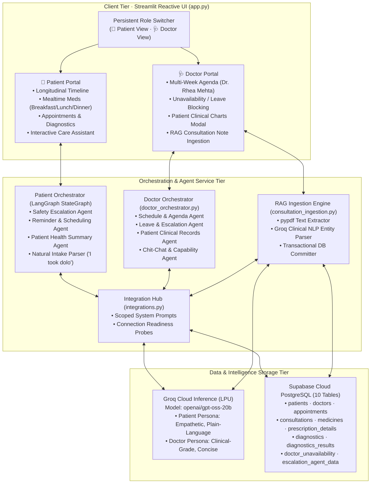
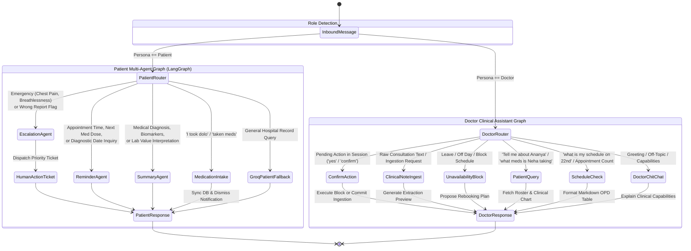
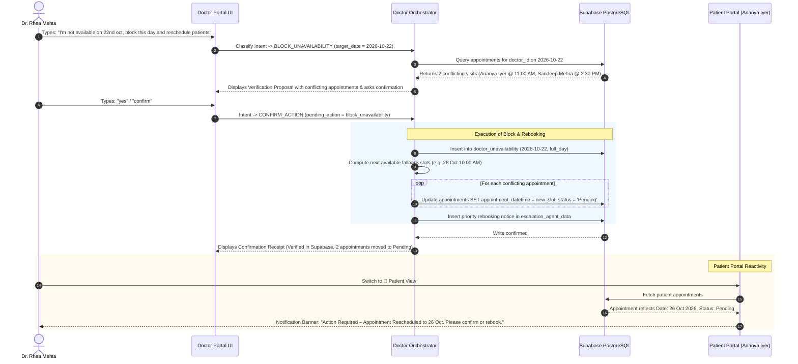
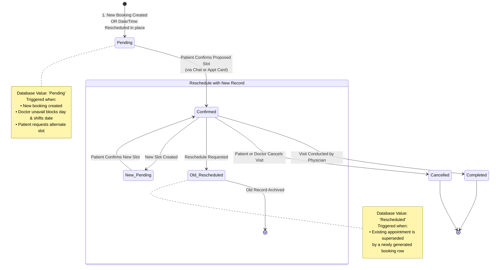
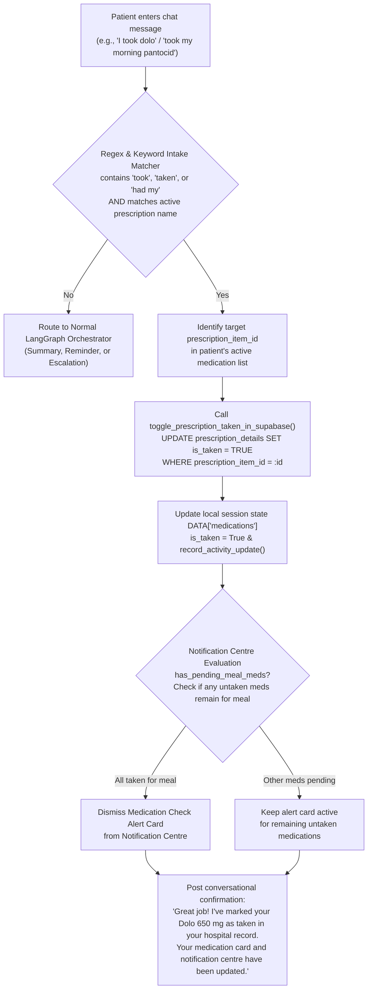
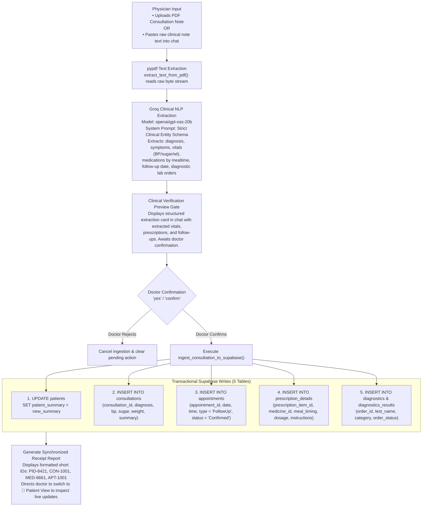
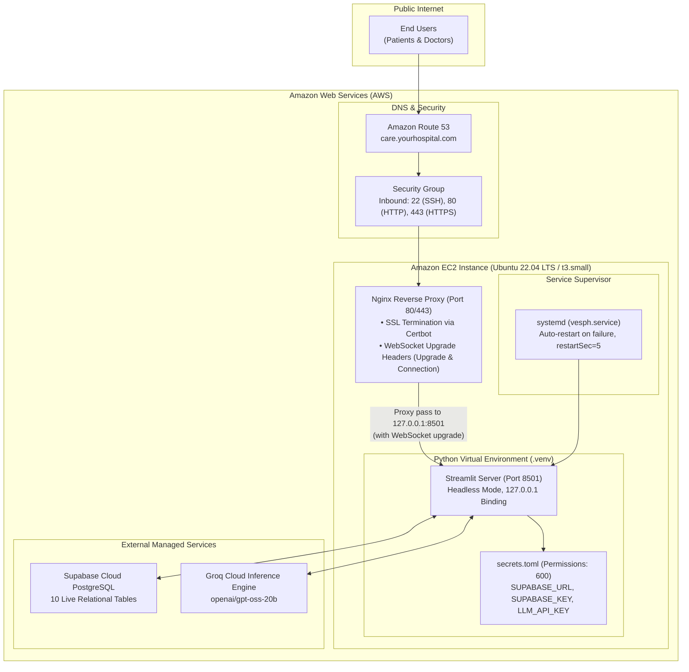

# VESPH Care — Virtual Engagement System for Patient Health
## Comprehensive Technical System Documentation & Architectural Specification

---

## Executive Summary

**VESPH Care** (Virtual Engagement System for Patient Health) is an intelligent, multi-agent post-discharge clinical coordination platform. It bridges the critical communication and compliance gap between inpatient hospital discharge and outpatient recovery by delivering:

1. **An Empathetic Patient Portal:** Features structured recovery timelines, diagnostic reports, discharge instructions, mealtime-grouped medication tracking (Breakfast, Lunch, Dinner with live checkoff), appointment management with auto-accepted slot rescheduling, and an interactive Care Assistant.
2. **A High-Efficiency Doctor Portal:** Tailored for attending physicians (modeled around Lead Laparoscopic Surgeon **Dr. Rhea Mehta**), featuring a weekly clinic agenda across active patients, schedule blocking with automated conflict rebooking, patient clinical chart reviews, and a **RAG Consultation Document Ingestion Agent** that reads doctor consultation notes/PDFs and synchronizes updates directly into the live clinical database.
3. **A Hybrid Agent Architecture:** Powered by LangGraph, Groq LLM (`openai/gpt-oss-20b`), and live Supabase PostgreSQL storage, combining deterministic clinical safety guards with scoped generative intelligence.
4. **Production-Ready AWS EC2 Infrastructure:** Packaged for persistent 24/7 background operation via `systemd` and Nginx reverse proxying with WebSocket upgrade support.

---

## 1. System Architecture & Dual-Portal Topology

VESPH Care unifies patient recovery and physician practice workflows around a single live database source of truth:



---

## 2. Multi-Agent Conversational Routing Architecture

VESPH Care deploys separate, specialized multi-agent graphs for the Patient and Doctor portals, guaranteeing deterministic safety and preventing cross-domain hallucinations.



---

## 3. Doctor Unavailability & Automated Conflict Rebooking Flowchart

When an attending physician blocks leave or an emergency surgery occurs, VESPH Care automatically evaluates conflicting appointments, calculates open fallback slots, updates database statuses, and dispatches patient escalations.



---

## 4. Appointment State Transition Machine & PostgreSQL Enum Hardening

In the live Supabase PostgreSQL database, the `appointments.status` column is strictly constrained to the custom enum `appointment_status_enum`. Any unmapped text representation throws error `22P02`. VESPH Care implements canonical normalization to enforce deterministic state transitions:



### PostgreSQL Status Normalization Mapping (`tools/db_tools.py`)

```python
VALID_APPOINTMENT_STATUSES = {
    "Confirmed",
    "Pending",
    "Completed",
    "Cancelled",
    "Rescheduled",
}

STATUS_NORMALIZATION_MAP = {
    "reschedule pending": "Pending",  # Date is changing, awaiting confirmation
    "rescheduled": "Rescheduled",
    "reschedule": "Pending",
    "pending confirmation": "Pending",
    "pending": "Pending",
    "confirmed": "Confirmed",
    "cancelled": "Cancelled",
    "canceled": "Cancelled",
    "completed": "Completed",
    "doctor unavailable (reschedule required)": "Cancelled",
    "doctor unavailable": "Cancelled",
    "unavailable": "Cancelled",
}
```

---

## 5. Patient Medication Adherence & Notification Dismissal Flow

VESPH Care connects patient conversational chat with electronic medication administration records (eMAR). When patients mention taking medicine in colloquial language, the system identifies the dose, mutates the database, and dismisses pending alerts.



---

## 6. RAG Consultation Document Ingestion Pipeline

The Doctor Portal provides an autonomous document ingestion pipeline that extracts unstructured consultation notes into normalized multi-table database records:



---

## 7. Standardized Short Identifier (ID) System Specification

To prevent raw 36-character UUID strings from cluttering the clinical user interface and conversational chat, VESPH Care implements a centralized short ID system:

| Entity Type | Raw Database Type | Short ID Format | Example | Source Generator |
|---|---|---|---|---|
| **Patient** | UUID v4 | `PID-XXXX` | `PID-8421` | `short_patient_id(pid)` |
| **Doctor** | UUID v4 | `DOC-XXXX` | `DOC-RHEA-01` | `short_doctor_id(did)` |
| **Medicine** | UUID v4 | `MED-XXXX` | `MED-6661` | `short_medicine_id(mid)` |
| **Appointment** | UUID v4 | `APT-XXXX` | `APT-1001` | `short_appointment_id(aid)` |
| **Consultation** | UUID v4 | `CON-XXXX` | `CON-1001` | `short_consultation_id(cid)` |
| **Diagnostic Lab** | UUID v4 | `LAB-XXXX` | `LAB-1001` | `short_diagnostic_id(did)` |

### Formatting Logic (`tools/db_tools.py`)
- Strips hyphens and extracts trailing uppercase alphanumeric characters.
- Overrides canonical demo fixtures (e.g. `22222222-...` maps to `PID-8421`, `11111111-...` maps to `DOC-RHEA-01`).
- Applied universally across timeline cards, detail popups, download filenames (e.g. `medication-MED-6661.txt`), clinical chart modals, and doctor chat responses.

---

## 8. Relational Database Schema & Data Dictionary

VESPH Care operates on 10 interconnected tables hosted on a live Supabase PostgreSQL instance:


---

## 9. AWS EC2 Production Deployment & Cloud Architecture



### Production `systemd` Configuration (`/etc/systemd/system/vesph.service`)
```ini
[Unit]
Description=VESPH Care Streamlit Service
After=network.target

[Service]
User=ubuntu
WorkingDirectory=/home/ubuntu/VESPH
ExecStart=/home/ubuntu/VESPH/.venv/bin/streamlit run app.py --server.port 8501 --server.address 127.0.0.1 --server.headless true --browser.gatherUsageStats false
Restart=always
RestartSec=5
Environment=PATH=/home/ubuntu/VESPH/.venv/bin:/usr/bin:/bin

[Install]
WantedBy=multi-user.target
```

### Production Nginx Reverse Proxy Configuration (`/etc/nginx/sites-available/vesph`)
```nginx
server {
    listen 80;
    server_name care.yourhospital.com;

    location / {
        proxy_pass http://127.0.0.1:8501;
        proxy_http_version 1.1;

        # WebSocket support (Critical for Streamlit reactive components)
        proxy_set_header Upgrade $http_upgrade;
        proxy_set_header Connection "upgrade";

        proxy_set_header Host $host;
        proxy_set_header X-Real-IP $remote_addr;
        proxy_set_header X-Forwarded-For $proxy_add_x_forwarded_for;
        proxy_set_header X-Forwarded-Proto $scheme;

        proxy_read_timeout 86400;
        proxy_send_timeout 86400;
    }
}
```

---

## 10. Automated Test Suite Matrix

The platform is validated by 19 automated unit tests covering safety-critical routing, rescheduling state transitions, and database enum compatibility:

| Test Identifier | Target Test Class | Tested User Scenario | Verified Assertion | Status |
|---|---|---|---|---|
| **TEST-01** | `TestPatientOrchestrator` | "Tell me about Dr. Rhea Mehta" | Doctor credentials, qualifications, room number | **PASS** |
| **TEST-02** | `TestPatientOrchestrator` | "What is my recovery trend?" | Historical biomarker trend & surgical clearance | **PASS** |
| **TEST-03** | `TestPatientOrchestrator` | "What is my medication adherence?" | Prescribed vs. taken ratio (33% adherence) | **PASS** |
| **TEST-04** | `TestPatientOrchestrator` | "When is my upcoming appointment?" | Next visit date, location, and prep instructions | **PASS** |
| **TEST-05** | `TestPatientOrchestrator` | "I took dolo" | Natural intake acknowledgment & `is_taken = True` | **PASS** |
| **TEST-06** | `TestPatientOrchestrator` | `normalize_appointment_status` | Maps "Reschedule Pending" strictly to "Pending" | **PASS** |
| **TEST-07** | `TestPatientOrchestrator` | `normalize_appointment_status` | Maps "Doctor Unavailable" strictly to "Cancelled" | **PASS** |
| **TEST-08** | `TestPatientOrchestrator` | `normalize_appointment_status` | Validates all outputs belong to `VALID_APPOINTMENT_STATUSES` | **PASS** |
| **TEST-09** | `TestDoctorOrchestrator` | "What's my schedule on 21st oct?" | Matches appointment count and returns OPD table | **PASS** |
| **TEST-10** | `TestDoctorOrchestrator` | "What's my schedule on 22nd oct?" | Accurately extracts ordinal dates ("22nd oct") | **PASS** |
| **TEST-11** | `TestDoctorOrchestrator` | "What's my schedule on 1st oct?" | Distinguishes single-digit from compound numbers | **PASS** |
| **TEST-12** | `TestDoctorOrchestrator` | "I'm not available on 22nd oct" | Generates unavailability proposal with conflicts | **PASS** |
| **TEST-13** | `TestDoctorOrchestrator` | "Tell me about Ananya Iyer" | Searches patient roster and confirms profile | **PASS** |
| **TEST-14** | `TestDoctorOrchestrator` | "What medication is Ananya Iyer taking?" | Recognizes patient and lists active prescriptions | **PASS** |
| **TEST-15** | `TestDoctorOrchestrator` | "Hello" / "Who are you?" | Responds with doctor capabilities and agenda options | **PASS** |
| **TEST-16** | `TestDoctorOrchestrator` | "Yes" with pending block action | Executes Supabase leave block and rebooking | **PASS** |
| **TEST-17** | `TestDoctorOrchestrator` | Consultation note extraction | Extracts diagnosis, vitals, prescriptions, and follow-ups | **PASS** |
| **TEST-18** | `TestDoctorOrchestrator` | "What's the weather today?" | Deflects non-medical chit-chat to clinical capabilities | **PASS** |
| **TEST-19** | `TestDoctorOrchestrator` | Fallback month matching | Defaults omitted months to active week's month | **PASS** |

Execution command:
```bash
python -m unittest discover tests -v
```

---

## 11. Engineering Challenges & Solutions

| Challenge Encountered | Root Cause | Engineering Solution |
|---|---|---|
| **PostgreSQL 22P02 Enum Error** | Code attempted to set `status = "Reschedule Pending"`, which is not declared in Supabase's `appointment_status_enum`. | Implemented `STATUS_NORMALIZATION_MAP` and `normalize_appointment_status`. When dates are changing, status is automatically normalized to `"Pending"` (awaiting patient confirmation) or `"Rescheduled"` on superseded records. |
| **Medication Name Redundancy** | Brand names in pharmaceutical catalogs sometimes contained dosage numbers (e.g. *Dolo 650*), resulting in display strings like *"Dolo 650 650 mg"*. | Cleaned baseline seed data and implemented regex deduplication `re.sub(r'\s*\d+\s*$', '', brand)` before concatenating dosage strings. |
| **Streamlit WebSocket Drops on EC2** | Streamlit UI became unresponsive or disconnected when accessed through standard HTTP reverse proxies. | Configured Nginx with persistent WebSocket upgrade directives (`proxy_set_header Upgrade $http_upgrade`, `proxy_set_header Connection "upgrade"`, `proxy_read_timeout 86400`). |
| **Raw UUID Visual Clutter** | 36-character hexadecimal UUIDs appeared in appointment cards, charts, and agent replies. | Built a centralized short ID system (`tools/db_tools.py`) mapping UUIDs into clean clinical badges (`PID-8421`, `DOC-RHEA-01`, `MED-6661`, `APT-1001`, `CON-1001`, `LAB-1001`). |
| **Multi-Table RAG Ingestion Sync** | Consultation notes combine diagnosis, vitals, future visits, and drugs into a single text block. | Engineered `tools/consultation_ingestion.py` using `pypdf` and Groq JSON entity extraction, followed by synchronized writes across 5 relational tables upon doctor confirmation. |

---

## 12. Conclusion & Future Roadmap

VESPH Care provides an enterprise-ready blueprint for post-discharge clinical coordination. By fusing deterministic state machines for safety-critical actions with scoped LLM extraction and relational PostgreSQL persistence, it reduces physician administrative overhead while providing patients with clear, structured recovery guidance.

### Future Roadmap
1. **FHIR R4 / HL7 Integration:** Direct bi-directional integration with hospital EHRs (Epic, Cerner).
2. **Omni-Channel Patient Notifications:** Automated WhatsApp Business API and SMS triggers for mealtime medication reminders and schedule change alerts.
3. **Multilingual Regional Support:** Localization for regional Indian languages (Hindi, Marathi, Tamil, Telugu).
4. **Computer Vision Lab Reader:** Multimodal vision parsing of printed pathology and diagnostic imaging reports.
